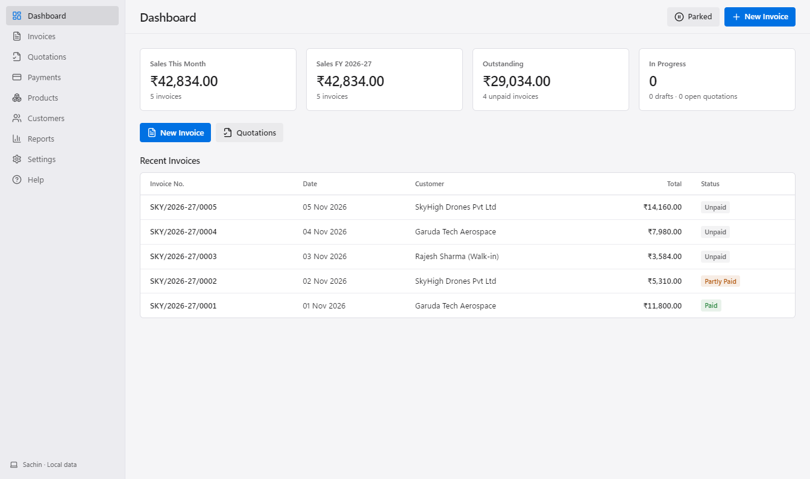
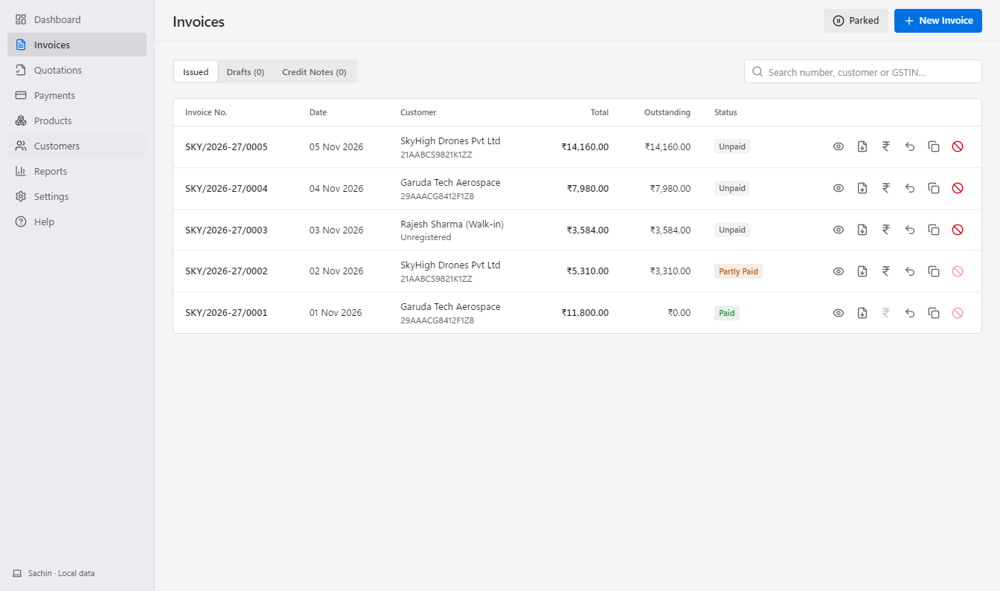
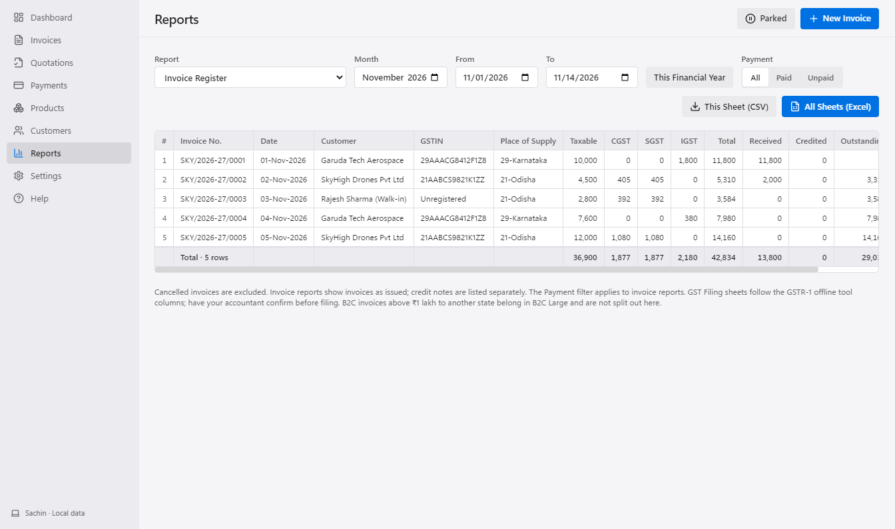
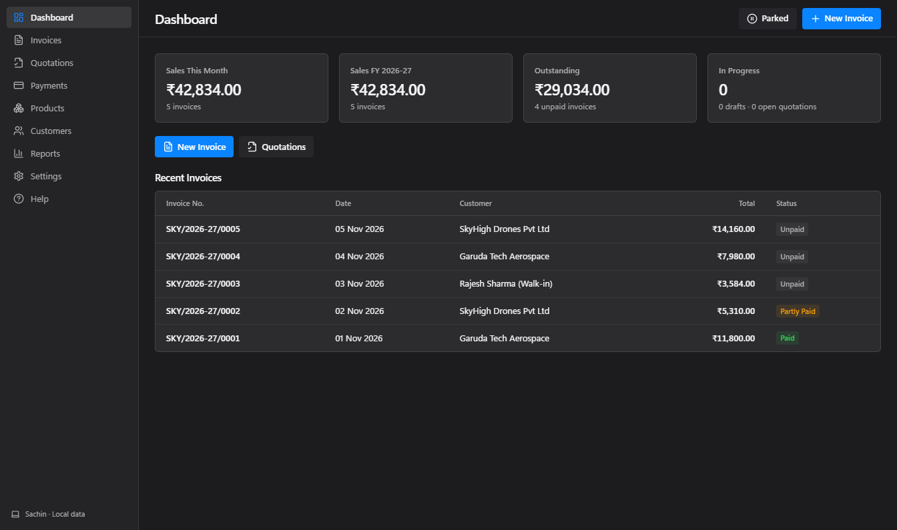
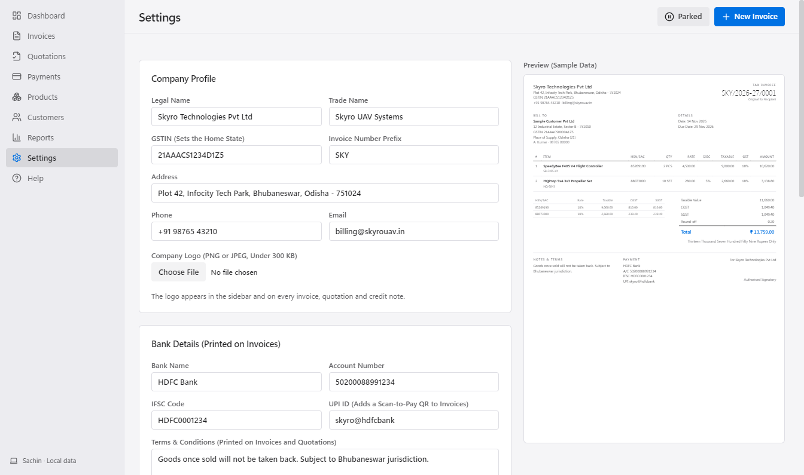
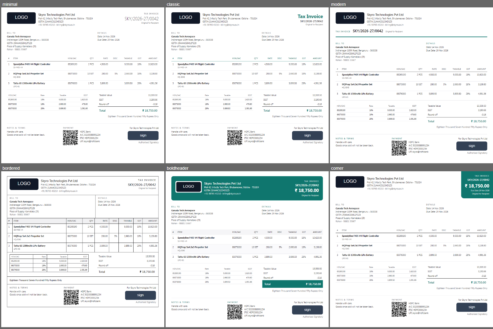

<div align="center">


# Skyro Biller

**Smart GST billing for Windows. Fast to bill. Remembers your products and customers.**

[](#install)
[](https://www.electronjs.org)
[](https://react.dev)
[](https://www.typescriptlang.org)
[](#how-your-data-is-kept-safe)

<br>



</div>

<br>

Skyro Biller is a desktop billing program built for a UAV parts business in India. Pick a customer, search for parts, and the invoice fills itself in: HSN codes, GST rates, CGST/SGST or IGST by place of supply, due dates, and the next consecutive invoice number. Then print it, save a PDF, or take the month's figures to your accountant as an Excel file.

It runs on one computer and keeps everything in a local database. No account, no internet needed.

> **Status:** version 1.0.0, local-only. Login, multi-computer sync and automatic updates are planned for a later online phase. See [Roadmap](#roadmap) and [Before real billing](#before-real-billing).

## Highlights

|  |  |
| --- | --- |
| **Product and customer memory** | Search as you type, in any word order. One pick fills the whole line or the whole bill-to. |
| **Indian GST, done for you** | CGST + SGST within your state, IGST outside it. HSN summary, round-off, amount in words. |
| **Consecutive invoice numbers** | `SKY/2026-27/0001`, restarting each financial year. Issued invoices are locked by the database. |
| **Drafts that never get lost** | Autosave, park a bill for a waiting customer, resume later. Closing the window saves first. |
| **Credit notes and payments** | Part payments, overdue marking, credit notes in their own number series. |
| **13 invoice templates** | Accent colour, three text sizes, logo, signature, UPI scan-to-pay QR, Original / Duplicate / Triplicate copies. |
| **GST filing sheets** | GSTR-1 style B2B, B2C, HSN and credit note sheets. One click exports every report as an Excel workbook. |
| **First-run tutorial** | A guided tour of every screen and menu starts on first launch. Replay it any time from Help > Start Tutorial. |
| **A proper Windows program** | Menu bar, keyboard shortcuts, light and dark theme, built-in help, installer. |

## Screenshots

<table>
  <tr>
    <td width="50%"><br><sub><b>Invoices.</b> View, save PDF, record payment, credit note, duplicate, cancel.</sub></td>
    <td width="50%"><br><sub><b>Reports.</b> Spreadsheet-style tables with totals, month picker and Paid / Unpaid filter.</sub></td>
  </tr>
  <tr>
    <td width="50%"><br><sub><b>Dark theme.</b> Light, Dark, or follow Windows.</sub></td>
    <td width="50%"><br><sub><b>Settings.</b> Company profile, bank details and a live invoice preview.</sub></td>
  </tr>
</table>

<details>
<summary><b>Invoice templates</b></summary>
<br>

<sub>Six of the 13 layouts, shown here with a sample logo and a teal accent. Every template carries the same content.</sub>
</details>

## Install

There is no download page yet. Build the installer yourself:

```bash
git clone https://github.com/Sachin1724/Skyrobiller.git
cd Skyrobiller
npm install
npm run build:win
```

`release/` then holds a setup program (`Skyro Biller Setup 1.0.0.exe`) and a portable version (`Skyro Biller 1.0.0.exe`). The installer is not code-signed, so Windows will warn about an unknown publisher.

## Develop

```bash
npm install
npm run dev     # app with hot reload
npm run check   # GST arithmetic and every database rule
npm run build   # type-check and production build
```

Needs Node.js on Windows (developed with v24).

## How it works

```
Windows app (Electron)
├── React + TypeScript + Tailwind   screens, forms, search, invoice editor
├── Main process                    menu bar, printing, PDF, backup, window state
└── SQLite (sql.js)                 products, customers, drafts, invoices, payments, credit notes
```

- **One database file** in the user's app data folder. Each save is written to a temporary file and swapped in, so a crash cannot leave it half-written.
- **Business rules live in the database**, not only on screen: issued invoices and credit notes cannot be edited or deleted, payments cannot exceed what is owed, credit cannot exceed the invoice, and issuing the same draft twice fails instead of duplicating.
- **PDF and print** use Electron's Chromium: one HTML body, thirteen CSS looks.

### Project layout

| Path | What is there |
| --- | --- |
| `electron/main/` | Window, menu bar, database, schema, printing |
| `src/features/` | One folder per screen: invoices, quotations, payments, products, customers, reports, settings, help |
| `src/lib/` | GST engine, database access, PDF templates, CSV |
| `scripts/` | Automated checks run by `npm run check` |
| `docs/` | Implementation plan, build report, capabilities report |

## Keyboard shortcuts

| Keys | Action |
| --- | --- |
| `Ctrl+N` / `Ctrl+Shift+N` | New invoice / new quotation |
| `Ctrl+S` | Save the open draft now |
| `Ctrl+Shift+S` / `Ctrl+P` | Save as PDF / print |
| `Ctrl+F` | Jump to the search box |
| `Ctrl+1` to `Ctrl+8` | Switch screen |
| `Ctrl+Shift+P` | Parked invoices |
| `F1` | Help |

## Before real billing

- **Set your real company profile** in Settings. The app ships with placeholder details, and an issued invoice keeps whatever was saved at that moment.
- **Have an accountant check the GST output.** The GSTR-1 sheets follow the offline tool's columns but have not been uploaded to the GST portal. B2C Large invoices are not split out.
- **Use one computer only.** Each computer would start its own invoice number series until cloud numbering exists.
- **Back up by hand** with File > Back Up Data. There is no automatic backup yet.

## Roadmap

- [x] Desktop foundation, product and customer memory
- [x] Invoice and quotation editor, GST engine, drafts, PDF and print
- [x] Local invoice numbering, payments, credit notes, reports, Excel export
- [x] Windows menu bar, themes, customisation, help, installer
- [ ] Login, roles and device approval
- [ ] Cloud database, multi-computer sync, atomic cloud numbering
- [ ] Google Sheets reporting
- [ ] Automatic updates and a code-signed installer

Details are in the [implementation plan](docs/plans/2026-11-14-skyro-biller-implementation-plan.md) and the [build report](docs/BUILD_REPORT.md).

## Credits

Invoice layouts, quotation lifecycle and credit notes draw on the ideas of [Invoify](https://github.com/al1abb/invoify), [SolidInvoice](https://github.com/SolidInvoice/SolidInvoice) and [InvoicePlane](https://github.com/InvoicePlane/InvoicePlane), all MIT-licensed.
