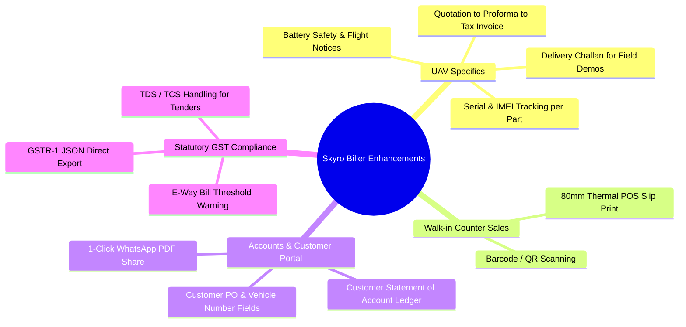

# Skyro Biller: Invoice Editing, Media Optimization, Payments & Feature Brainstorm Plan

---

## 1. Issue Analysis & Targeted Solutions

### Problem 1: No Way to Re-Edit Created/Issued Invoices
* **Root Cause:** 
  1. The SQLite database schema (`electron/main/schema.ts`) has a strict trigger (`trg_invoice_immutable`) that throws an unhandled error: `SELECT RAISE(ABORT, 'Issued invoices cannot be edited')` on any `UPDATE` statement.
  2. The UI in `InvoicesView.tsx` only offers `View`, `Save PDF`, `Record Payment`, `Credit Note`, `Duplicate`, and `Cancel`—there is no `Edit` action.
* **Proposed Solution:**
  1. Modify `trg_invoice_immutable` to protect **only** the sequential integrity columns (`id`, `invoice_number`, `financial_year`, `seq`), while permitting updates to content columns (`customer_id`, `customer_name`, `customer_json`, `items_json`, `totals_json`, `total`, `notes`, `due_date`).
  2. Implement `updateInvoice()` in `src/lib/db.ts` to execute content updates.
  3. Add an **"Edit Invoice"** button (<Pencil>) on invoice rows and inside the preview modal.
  4. Enhance `InvoiceEditor.tsx` with an `editingInvoice` mode:
     - Header displays: `Editing Invoice · {invoiceNumber}`.
     - Preserves the existing invoice number and financial year sequence.
     - Saves updates in place without consuming a new sequence number.

---

### Problem 2: Invoice Logo Needs Auto-Compression & Resizing
* **Root Cause:**
  - `SettingsView.tsx` enforces a rigid `MAX_IMAGE_BYTES = 300 * 1024` check. Any image above 300 KB is rejected with an error instead of being resized.
* **Proposed Solution:**
  1. Create a dedicated client-side image utility (`src/lib/image.ts`).
  2. Automatically scale images down to optimal header dimensions:
     - **Company Logo:** Max 400px width × 160px height (proportional).
     - **Authorized Signature:** Max 300px width × 100px height.
  3. Use an off-screen HTML5 `<canvas>` with bicubic image smoothing (`imageSmoothingQuality = 'high'`) to compress multi-megabyte images (from cameras or design tools) down to ~25 KB – 45 KB WebP/PNG.
  4. Display live feedback in Settings: `✓ Auto-compressed: 2.8 MB → 32 KB (380 × 120 px, 98% saved)`.

---

### Problem 3: Invoices on Home/Dashboard Cannot Be Clicked to Preview
* **Root Cause:**
  - `DashboardView.tsx` renders recent invoices as plain `<tr>` elements without `onClick` listeners or preview triggers.
* **Proposed Solution:**
  1. Create a shared `InvoicePreviewModal.tsx` component.
  2. In `DashboardView.tsx`, attach click handlers to table rows (`cursor-pointer hover:bg-surface-2`) and add an eye preview icon button.
  3. Clicking any invoice immediately opens `InvoicePreviewModal`, showing:
     - The pixel-perfect printable A4 document.
     - Prominent status badge (`Paid in Full`, `Partially Paid`, `Unpaid`).
     - Paid amount and Balance Outstanding.
     - Action buttons: 🖨️ **Print**, 📥 **Save PDF**, ✏️ **Edit Invoice**, 💰 **Record Payment**, 📋 **Duplicate as Draft**.

---

### Problem 4: Partial Payments & Full Payments Management
* **Root Cause:**
  - The existing `PaymentModal.tsx` only offers a raw input defaulting to the full amount. It lacks quick-action split buttons, live balance calculation, and installment history.
* **Proposed Solution:**
  1. Enhance `PaymentModal.tsx` with:
     - Total Billed, Total Received, and Current Outstanding Due.
     - **Quick Payment Shortcut Buttons:**
       - `[Full Balance (₹{due})]`
       - `[50% Partial (₹{due/2})]`
       - `[25% Partial (₹{due/4})]`
       - `[Custom Amount]`
     - **Live Balance Projection:** Displays: *"After paying ₹{amount}, remaining balance will be ₹{balance} ({Partially Paid / Paid in Full})"* before saving.
     - **Payment History Ledger:** Embedded table listing all prior installments (Date, Mode, Reference, Amount).

---

## 2. In-Depth Feature Brainstorm: What's Missing in Our UAV Biller System?

Based on typical operations in a UAV (Unmanned Aerial Vehicle) parts and commercial drone enterprise in India, here are high-impact capabilities missing from the current setup:

### 1. UAV & Component-Specific Invoicing Features
* **Serial Number & Batch/Lot Tracking:**
  - Flight controllers, electronic speed controllers (ESCs), digital VTX units (e.g. DJI O3, Caddx Vista), and brushless motors carry unique serial numbers. Customers require these on invoices for manufacturer warranty claims and RMA returns.
* **Proforma Invoice (PI) Pipeline:**
  - UAV corporate clients, defense contractors, and university robotics labs usually require a **Proforma Invoice** before releasing funds or issuing Purchase Orders.
  - *Workflow:* Quotation → Proforma Invoice → Payment Advance → Final Tax Invoice.
* **GST Delivery Challan (Rule 55):**
  - Drone parts and assembled drones frequently leave the warehouse for client flight demonstrations, calibration, or repairs without a sale having occurred. Generating statutory Delivery Challans is legally mandatory for moving goods.

### 2. Retail Counter & Speed of Billing
* **80mm Thermal Receipt (POS Roll Printer):**
  - While B2B drone clients need formal A4 tax invoices, local drone pilots and walk-in FPV hobbyists buying replacement propellers, screws, standoffs, or solder paste need a fast, 3-inch roll receipt.
* **Barcode / QR Code Scanner Input:**
  - UAV components come in anti-static bags with manufacturer barcodes. Supporting USB barcode scanners in the product autocomplete search box allows 1-second item addition.

### 3. Client Account Management & Customer Experience
* **Customer Ledger (Statement of Account):**
  - Regular B2B drone clients buy multiple times per month. They need a single consolidated ledger showing: Invoices Billed, Payments Received, Credit Notes, and Net Outstanding Balance.
* **1-Click WhatsApp & Email Sharing:**
  - A quick "Share to WhatsApp" button that launches WhatsApp Web or desktop with a pre-filled message: *"Hello [Customer], your invoice [INV-2026-0042] for ₹45,200 is ready. Balance: ₹0. View PDF here."*
* **Purchase Order (PO) & Vehicle Number Custom Fields:**
  - B2B procurement teams require their internal PO number, PO date, and transporter vehicle number printed on the invoice.

### 4. Statutory & Advanced Taxation
* **E-Way Bill Helper (Consignments > ₹50,000):**
  - Automatic banner when an inter-state invoice exceeds ₹50,000: *"E-Way Bill Required: Distance, Transporter ID, Vehicle No."*
* **Credit Limit & Overdue Warning:**
  - If a customer has unpaid invoices older than their agreed payment terms (e.g., 30 days overdue), the system warns the billing clerk before issuing new stock.

---

## 3. Step-by-Step Implementation Sequence

1. **Step 1: Database Trigger & `updateInvoice` Schema Update**
   - Update `electron/main/schema.ts` to allow content updates on `local_invoices`.
   - Add `updateInvoice()` and `listPaymentsForInvoice()` in `src/lib/db.ts`.
2. **Step 2: Client-Side Image Resizer & Compressor**
   - Add `src/lib/image.ts` with canvas-based resolution optimization.
   - Wire into `SettingsView.tsx` with compression savings feedback.
3. **Step 3: Click-to-Preview Modal (Dashboard & Invoices)**
   - Create `src/components/InvoicePreviewModal.tsx`.
   - Make table rows clickable in `DashboardView.tsx` and `InvoicesView.tsx`.
4. **Step 4: Invoice Re-Editing in `InvoiceEditor.tsx`**
   - Enable editing existing invoices with in-place saving and sequence preservation.
   - Add "Edit Invoice" buttons in the invoice list and preview modal.
5. **Step 5: Partial & Full Payment Installment UI**
   - Update `PaymentModal.tsx` with one-click full/partial split buttons, live balance calculation, and installment history.
