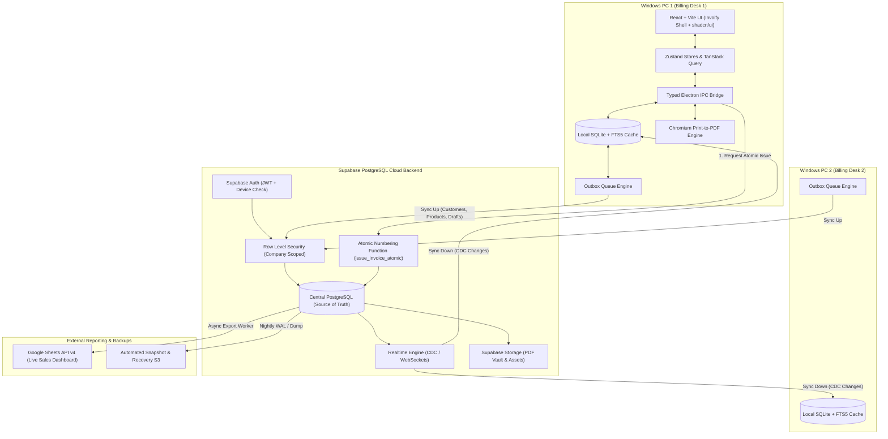
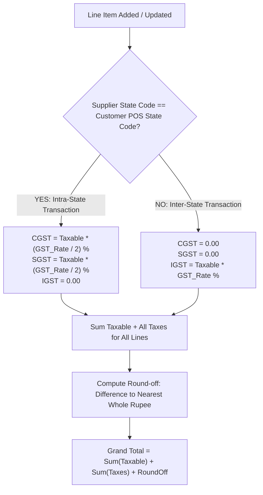

# Skyro Biller: Production Implementation Plan & Architecture Specification (v1.0)

> **Execution Directive:** This document serves as the master engineering implementation blueprint for **Skyro Biller**, a multi-user, offline-capable Windows billing application engineered specifically for a UAV parts enterprise under Indian GST regulations.

> **Revision 2 (2026-11-14) — supersedes any conflicting text below.**
> 1. **Local DB is `sql.js` (WASM SQLite), not `better-sqlite3`.** No native build step on Windows. The DB lives in memory and is written to disk after every mutation with write-to-temp-then-rename, so a crash cannot truncate the file. Revisit `better-sqlite3` + WAL only if the whole-file save becomes slow (tens of MB).
> 2. **No FTS5.** The stock `sql.js` build does not include it. Search is a multi-word `LIKE` over SKU, name, brand and aliases (every typed word must match, any order). Adequate to roughly 50k rows; a custom FTS5 build is the upgrade path.
> 3. **No migration runner yet.** The schema is `CREATE ... IF NOT EXISTS` and runs on every start. Add `PRAGMA user_version` migrations the first time a column must change.
> 4. **Forms use native HTML validation** (`required`, `pattern`, `min`). React Hook Form + Zod stay installed for the first form that needs cross-field rules beyond that.
> 5. **Money maths runs in integer paise** (`src/lib/gst.ts`); CGST and SGST are each rounded separately so they are always equal.
> 6. **Draft IDs are `D-XXXXXXXX`** (random, collision-safe across PCs without a device prefix). Autosave is debounced 600 ms after the last edit, not a 5-second timer.
> 7. **Catalogue and customer rows created before Phase 5 are not queued in `sync_outbox`.** Phase 5 starts with a one-time full push of local rows by `updated_at`.
> 8. **Status:** Phase 1 done. Phase 2 done (product memory, customer memory, search, autocomplete). Phase 3 partly done: GST engine, invoice editor, autosaved drafts, park/resume. Remaining in Phase 3: quotations (Task 3.3) and PDF templates (Task 3.4).
> 9. **Checks:** `npm run check` runs `scripts/gst.check.ts` (GST maths) and `scripts/db.check.ts` (catalogue, customer and draft SQL against the real schema).

> **Revision 3 (2026-11-14) — local-first build order. Supersedes Revision 2 item 8 and the phase order below.**
> 1. **Order changed:** the whole product is built and usable on one computer first. Supabase (auth, device approval, sync, cloud numbering) and Google Sheets are added last.
> 2. **Invoices are issued locally.** `local_invoices` stores full snapshots; the number `PREFIX/2026-27/0001` is allocated inside the same INSERT, consecutive per financial year. The invoice reuses the draft id as primary key, so a retry cannot create a duplicate. Database triggers block edits and deletes of issued invoices; cancelling only changes status. When the cloud is connected, that one INSERT moves into the Postgres RPC.
> 3. **Until the cloud is connected, issue invoices from one computer only.** Two computers would each start their own number series.
> 4. **Payments** are stored in `local_payments`; a trigger rejects overpayment and payments on cancelled invoices. Paid / partly paid / unpaid is derived, not stored.
> 5. **Quotations** are rows in `local_drafts` with `kind = 'quotation'`, a validity date and a status (draft, sent, accepted, declined, converted — SolidInvoice's lifecycle). Converting copies the quotation into a new invoice draft.
> 6. **PDF:** one shared HTML body with three looks chosen in Settings (Minimal, Classic, Modern; adapted from Invoify layouts) in `src/lib/pdf.ts`, rendered by `printToPDF`. Includes logo, HSN-wise tax summary, amount in words, UPI scan-to-pay QR (`qrcode` package) and copy markings (Original / Duplicate / Triplicate, one full copy each). Template, logo and copies are current settings, not part of the invoice snapshot. Settings shows a live preview.
> 7. **Reports** are computed from issued invoices in the renderer and exported as CSV. Google Sheets sync comes with the cloud phase.
> 8. **Backup and restore** of the database file are in Settings.
> 9. **Interface:** semantic colour tokens in `src/index.css` (light and dark follow Windows), system font, component classes (`.btn`, `.field`, `.card`, `.tbl`, `.badge`, `.sheet`), native `<dialog>` for modals. shadcn/ui is not used.
> 10. **Launch fixes:** the app could not start before this revision (CommonJS import of `node-machine-id`, missing `__dirname` in the ES module bundle, preload built as ESM). The preload is now built as `preload.cjs`.
> 11. **Not built yet:** employee roles and everything cloud.

> **Revision 4 (2026-11-14) — features taken from the reference projects.**
> 1. **From Invoify:** all thirteen layouts of its template gallery as PDF looks (Minimal, Classic, Modern, Bordered, Bold Header, Corner, Statement, Two-Tone, Letterhead, Left Rail, Sidebar, Column, Compact), its accent presets plus a custom colour, its density setting, and a signature image. One shared HTML body in `src/lib/pdf.ts`; each look is CSS only. This supersedes "three looks" in Revision 3 item 6.
> 2. **From InvoicePlane:** credit notes (its credit invoices) with their own `CN/2026-27/0001` series in `local_credit_notes`, immutable, capped by trigger at the invoice value, and counted in outstanding; copy an invoice into a new draft; in-app document view; CSV import for products (updates an existing SKU) and customers (skips an existing GSTIN); aging report.
> 3. **From SolidInvoice:** quotation lifecycle (already in Revision 3) and customer billing history.
> 4. **Product memory learns from billing:** a one-off custom item can be typed into an invoice and saved to the catalogue from its row.
> 5. **Company logo** is shown in the sidebar and printed on every document.
> 6. **Deliberately left out:** recurring invoices, emailing PDFs, online payment gateways, multi-currency, translations, client portal, REST API, custom fields, projects and tasks. They need a server or fall outside the product brief (section 14); signature drawing/typing is replaced by an image upload.
> 7. **Known limits:** Sales and GST reports show invoices as issued; credit notes are a separate report to subtract. Returned quantity per line is not tracked across several credit notes, only the total.

> **Revision 5 (2026-11-14) — Windows program conventions.**
> 1. **Standard Windows frame and menu bar** replace the custom title bar. The menu is defined in `electron/main/menu.ts`; each item sends an action name to the renderer (`src/App.tsx`), and the screen that owns the command carries it out through `useMenuAction`.
> 2. **Menus:** File (new documents, Save, Save Copy, Save As PDF, Print, Import, Export, Back Up, Restore, Exit), Edit (clipboard, Find), View (screens on Ctrl+1 to Ctrl+8, Parked, Theme, Zoom, Full Screen), Tools (Settings, Invoice Design, Customize), Help (Help on F1, Keyboard Shortcuts, Check for Updates, Open Data Folder, About).
> 3. **Save semantics:** the app autosaves, so Save writes the open draft immediately, Save Copy duplicates it, Save As PDF and Print act on the open quotation or the invoice or credit note being viewed. Invoice drafts cannot be printed as tax invoices. Closing the window saves an open draft first.
> 4. **Theme:** Light, Dark or Follow Windows via `nativeTheme.themeSource`, remembered. **Customize** (Settings): app accent colour, table row height, start-up screen, default GST rate, default payment terms, dashboard cards. Stored under the `prefs` key in `local_settings`.
> 5. **Also:** window size and position remembered, single running copy enforced, app icon in `resources/icon.png` (placeholder artwork), in-app Help screen, direct printing through the Windows print dialog.
> 6. **Check for Updates** shows the installed version only. Automatic updates wait on a decision about where releases are hosted and whether the installer is code-signed.
> 7. **Installer:** `npm run build:win` produces a setup program and a portable exe in `release/`. The packaged app was launched and exercised; the setup program itself has not been run on a clean computer.
> 8. **Reports** are spreadsheet-style tables with CSV and multi-sheet Excel export, including GSTR-1 style sheets.

---

## 1. Executive Summary & Architectural Overview

### 1.1 Goal
Build **Skyro Biller**, a resilient, offline-capable Windows desktop application that accelerates invoicing, eliminates manual re-entry via **Product & Customer Memory**, guarantees **consecutive zero-duplicate Indian GST invoice numbering** across concurrent multi-computer setups, and continuously synchronizes with a central PostgreSQL cloud backend (Supabase) and Google Sheets reporting.

### 1.2 Core Architectural Principles
1. **Local-First with Cloud Authority:** Each Windows client runs an embedded **SQLite** database containing cached catalogues, customers, drafts, and outbox sync queues. The authoritative source of truth for issued invoices, sequential numbering, and global access is **Supabase PostgreSQL**.
2. **Zero-Duplicate Sequential Numbering:** Drafts and parked invoices never consume official invoice numbers. Allocation of the official sequential tax invoice number is strictly atomic, handled on the PostgreSQL backend using `SELECT ... FOR UPDATE` row locks within a serializable transaction.
3. **Hardware-Enforced Multi-Tenancy & Device Authorization:** Client machines generate a deterministic hardware fingerprint (`machine-id` + platform UUID). Access to company records requires both valid employee credentials and an **Approved** device record in PostgreSQL.
4. **Resilient Offline Billing:** Employees can search cached inventories, fill customer details, calculate GST, and park or save draft invoices completely offline. Network connectivity is strictly mandated only at the exact instant of authoritative tax invoice issuance.
5. **Indian GST Compliance:** Native support for CGST + SGST (intra-state) vs IGST (inter-state), HSN/SAC codes, reverse charge mechanism (RCM), place of supply determination, and B2B vs B2C invoice schemas.

---

## 2. High-Level System Architecture & Data Flow



---

## 3. Technology Stack & Design Contracts

| Layer | Technology | Selection Justification |
| :--- | :--- | :--- |
| **Desktop Runtime** | Electron (v32+) + `electron-builder` | Native Windows 10/11 shell integration, hardware UUID access, headless Chromium PDF rendering, background sync daemon. |
| **Frontend Framework** | React 18+ / Vite / TypeScript | Rapid component rendering, strict typings, instant HMR, high performance. |
| **Component System** | Tailwind CSS v4 + shadcn/ui (Radix UI) | Clean, keyboard-accessible, enterprise-grade dark/light UI adapted from modern Invoify patterns. |
| **State & Forms** | Zustand + TanStack Query + React Hook Form + Zod | Separation of local offline state, async server sync caching, and strict GST tax form validation. |
| **Local Cache DB** | `sql.js` (WASM SQLite) | No native compilation on Windows. In-memory DB in the Electron main process, persisted with atomic write-then-rename after each mutation. Multi-word `LIKE` search (see Revision 2). |
| **Cloud Source of Truth** | Supabase PostgreSQL 16+ | Enterprise relational ACID transactions, Row-Level Security (RLS), Realtime WebSocket updates, pg_cron. |
| **PDF Generation** | Electron `webContents.printToPDF` | Pixel-perfect A4 invoice output adhering to Section 31 of CGST rules without external heavy binary dependencies. |
| **External Reporting** | Google Sheets API v4 | Continuous background sync of sales summaries for executive oversight without granting direct DB access. |

---

## 4. Database Schema Specifications

### 4.1 Cloud PostgreSQL Schema (Supabase)

```sql
-- 1. EXTENSIONS
CREATE EXTENSION IF NOT EXISTS "uuid-ossp";
CREATE EXTENSION IF NOT EXISTS "pgcrypto";

-- 2. ENUMS
CREATE TYPE user_role AS ENUM ('owner', 'admin', 'billing_employee', 'viewer');
CREATE TYPE device_status AS ENUM ('pending', 'approved', 'rejected', 'revoked');
CREATE TYPE invoice_status AS ENUM ('draft', 'parked', 'issued', 'cancelled');
CREATE TYPE payment_status AS ENUM ('unpaid', 'partially_paid', 'paid');
CREATE TYPE payment_mode AS ENUM ('cash', 'upi', 'bank_transfer', 'cheque', 'credit');
CREATE TYPE quotation_status AS ENUM ('draft', 'sent', 'accepted', 'rejected', 'converted');

-- 3. COMPANIES & PROFILES
CREATE TABLE companies (
    id UUID PRIMARY KEY DEFAULT uuid_generate_v4(),
    legal_name TEXT NOT NULL,
    trade_name TEXT,
    gstin VARCHAR(15) NOT NULL UNIQUE,
    email TEXT NOT NULL,
    phone VARCHAR(15),
    address_line1 TEXT NOT NULL,
    address_line2 TEXT,
    city TEXT NOT NULL,
    state_name TEXT NOT NULL,
    state_code VARCHAR(2) NOT NULL, -- e.g., '21' for Odisha, '27' for Maharashtra
    pincode VARCHAR(10) NOT NULL,
    bank_name TEXT,
    account_number TEXT,
    ifsc_code TEXT,
    upi_id TEXT,
    logo_url TEXT,
    invoice_terms TEXT,
    financial_year_start DATE NOT NULL DEFAULT '2026-04-01',
    created_at TIMESTAMPTZ NOT NULL DEFAULT NOW(),
    updated_at TIMESTAMPTZ NOT NULL DEFAULT NOW()
);

CREATE TABLE profiles (
    id UUID PRIMARY KEY REFERENCES auth.users(id) ON DELETE CASCADE,
    company_id UUID NOT NULL REFERENCES companies(id) ON DELETE RESTRICT,
    full_name TEXT NOT NULL,
    role user_role NOT NULL DEFAULT 'billing_employee',
    is_active BOOLEAN NOT NULL DEFAULT TRUE,
    created_at TIMESTAMPTZ NOT NULL DEFAULT NOW(),
    updated_at TIMESTAMPTZ NOT NULL DEFAULT NOW()
);

-- 4. AUTHORIZED DEVICES (HARDWARE LOCK)
CREATE TABLE devices (
    id UUID PRIMARY KEY DEFAULT uuid_generate_v4(),
    company_id UUID NOT NULL REFERENCES companies(id) ON DELETE CASCADE,
    machine_fingerprint TEXT NOT NULL, -- SHA-256 of CPU ID + Motherboard UUID + Machine GUID
    device_name TEXT NOT NULL,
    registered_by UUID REFERENCES profiles(id),
    status device_status NOT NULL DEFAULT 'pending',
    approved_by UUID REFERENCES profiles(id),
    approved_at TIMESTAMPTZ,
    last_sync_at TIMESTAMPTZ,
    last_ip_address TEXT,
    created_at TIMESTAMPTZ NOT NULL DEFAULT NOW(),
    updated_at TIMESTAMPTZ NOT NULL DEFAULT NOW(),
    CONSTRAINT unique_device_per_company UNIQUE (company_id, machine_fingerprint)
);

-- 5. PRODUCT CATALOGUE (PRODUCT MEMORY)
CREATE TABLE products (
    id UUID PRIMARY KEY DEFAULT uuid_generate_v4(),
    company_id UUID NOT NULL REFERENCES companies(id) ON DELETE CASCADE,
    sku TEXT NOT NULL,
    name TEXT NOT NULL,
    brand TEXT,
    model TEXT,
    description TEXT,
    unit TEXT NOT NULL DEFAULT 'PCS',
    hsn_code VARCHAR(8) NOT NULL, -- 4, 6 or 8 digit Indian HSN
    gst_rate NUMERIC(5, 2) NOT NULL DEFAULT 18.00, -- e.g. 18.00 (split into 9+9 or 18 IGST)
    default_price NUMERIC(12, 2) NOT NULL DEFAULT 0.00,
    search_aliases TEXT[], -- Array of keywords/aliases
    is_active BOOLEAN NOT NULL DEFAULT TRUE,
    created_at TIMESTAMPTZ NOT NULL DEFAULT NOW(),
    updated_at TIMESTAMPTZ NOT NULL DEFAULT NOW(),
    CONSTRAINT unique_sku_per_company UNIQUE (company_id, sku)
);

-- 6. CUSTOMER DIRECTORY (CUSTOMER MEMORY)
CREATE TABLE customers (
    id UUID PRIMARY KEY DEFAULT uuid_generate_v4(),
    company_id UUID NOT NULL REFERENCES companies(id) ON DELETE CASCADE,
    business_name TEXT NOT NULL,
    contact_person TEXT,
    gstin VARCHAR(15), -- NULL for unregistered B2C consumer
    email TEXT,
    phone VARCHAR(15),
    billing_address TEXT NOT NULL,
    shipping_address TEXT,
    city TEXT NOT NULL,
    state_name TEXT NOT NULL,
    state_code VARCHAR(2) NOT NULL, -- determines CGST/SGST vs IGST
    pincode VARCHAR(10) NOT NULL,
    payment_terms_days INTEGER NOT NULL DEFAULT 15,
    is_active BOOLEAN NOT NULL DEFAULT TRUE,
    created_at TIMESTAMPTZ NOT NULL DEFAULT NOW(),
    updated_at TIMESTAMPTZ NOT NULL DEFAULT NOW()
);

-- 7. ATOMIC INVOICE SEQUENCES
CREATE TABLE invoice_sequences (
    company_id UUID NOT NULL REFERENCES companies(id) ON DELETE CASCADE,
    financial_year VARCHAR(10) NOT NULL, -- e.g., '2026-27'
    prefix VARCHAR(10) NOT NULL DEFAULT 'SKY',
    current_sequence INTEGER NOT NULL DEFAULT 0,
    PRIMARY KEY (company_id, financial_year, prefix)
);

-- 8. INVOICES (OFFICIAL & DRAFTS)
CREATE TABLE invoices (
    id UUID PRIMARY KEY DEFAULT uuid_generate_v4(),
    company_id UUID NOT NULL REFERENCES companies(id) ON DELETE CASCADE,
    draft_id TEXT NOT NULL, -- Client-generated draft id (e.g., DRF-PC1-20261114-001)
    invoice_number TEXT, -- Populated ONLY when issued (e.g., SKY/2026-27/0042)
    financial_year VARCHAR(10),
    sequence_number INTEGER,
    status invoice_status NOT NULL DEFAULT 'draft',
    issue_date DATE,
    due_date DATE,
    created_by UUID REFERENCES profiles(id),
    device_id UUID REFERENCES devices(id),
    
    -- Customer Snapshot at time of issue
    customer_id UUID REFERENCES customers(id),
    customer_name TEXT NOT NULL,
    customer_gstin VARCHAR(15),
    place_of_supply_state_code VARCHAR(2) NOT NULL,
    customer_address TEXT NOT NULL,
    
    -- Tax & Financial Totals
    taxable_amount NUMERIC(12, 2) NOT NULL DEFAULT 0.00,
    cgst_amount NUMERIC(12, 2) NOT NULL DEFAULT 0.00,
    sgst_amount NUMERIC(12, 2) NOT NULL DEFAULT 0.00,
    igst_amount NUMERIC(12, 2) NOT NULL DEFAULT 0.00,
    total_tax_amount NUMERIC(12, 2) NOT NULL DEFAULT 0.00,
    round_off NUMERIC(5, 2) NOT NULL DEFAULT 0.00,
    total_amount NUMERIC(12, 2) NOT NULL DEFAULT 0.00,
    
    -- Payment Aggregation
    paid_amount NUMERIC(12, 2) NOT NULL DEFAULT 0.00,
    payment_status payment_status NOT NULL DEFAULT 'unpaid',
    
    notes TEXT,
    pdf_url TEXT,
    cancellation_reason TEXT,
    cancelled_at TIMESTAMPTZ,
    
    created_at TIMESTAMPTZ NOT NULL DEFAULT NOW(),
    updated_at TIMESTAMPTZ NOT NULL DEFAULT NOW(),
    CONSTRAINT unique_invoice_number_per_company UNIQUE (company_id, invoice_number)
);

CREATE TABLE invoice_items (
    id UUID PRIMARY KEY DEFAULT uuid_generate_v4(),
    invoice_id UUID NOT NULL REFERENCES invoices(id) ON DELETE CASCADE,
    product_id UUID REFERENCES products(id),
    item_order INTEGER NOT NULL DEFAULT 1,
    sku TEXT NOT NULL,
    description TEXT NOT NULL,
    hsn_code VARCHAR(8) NOT NULL,
    quantity NUMERIC(10, 2) NOT NULL DEFAULT 1.00,
    unit TEXT NOT NULL DEFAULT 'PCS',
    unit_price NUMERIC(12, 2) NOT NULL,
    discount_percent NUMERIC(5, 2) NOT NULL DEFAULT 0.00,
    discount_amount NUMERIC(12, 2) NOT NULL DEFAULT 0.00,
    taxable_amount NUMERIC(12, 2) NOT NULL,
    gst_rate NUMERIC(5, 2) NOT NULL,
    cgst_amount NUMERIC(12, 2) NOT NULL DEFAULT 0.00,
    sgst_amount NUMERIC(12, 2) NOT NULL DEFAULT 0.00,
    igst_amount NUMERIC(12, 2) NOT NULL DEFAULT 0.00,
    total_amount NUMERIC(12, 2) NOT NULL
);

-- 9. PAYMENTS
CREATE TABLE payments (
    id UUID PRIMARY KEY DEFAULT uuid_generate_v4(),
    company_id UUID NOT NULL REFERENCES companies(id) ON DELETE CASCADE,
    invoice_id UUID NOT NULL REFERENCES invoices(id) ON DELETE CASCADE,
    payment_date DATE NOT NULL DEFAULT CURRENT_DATE,
    amount NUMERIC(12, 2) NOT NULL,
    mode payment_mode NOT NULL,
    reference_number TEXT,
    notes TEXT,
    recorded_by UUID REFERENCES profiles(id),
    created_at TIMESTAMPTZ NOT NULL DEFAULT NOW()
);

-- 10. QUOTATIONS
CREATE TABLE quotations (
    id UUID PRIMARY KEY DEFAULT uuid_generate_v4(),
    company_id UUID NOT NULL REFERENCES companies(id) ON DELETE CASCADE,
    quotation_number TEXT NOT NULL, -- e.g., QT-2026-0012
    customer_id UUID REFERENCES customers(id),
    customer_name TEXT NOT NULL,
    customer_gstin VARCHAR(15),
    place_of_supply_state_code VARCHAR(2) NOT NULL,
    quotation_date DATE NOT NULL DEFAULT CURRENT_DATE,
    valid_until DATE NOT NULL,
    status quotation_status NOT NULL DEFAULT 'draft',
    converted_invoice_id UUID REFERENCES invoices(id),
    taxable_amount NUMERIC(12, 2) NOT NULL,
    total_tax_amount NUMERIC(12, 2) NOT NULL,
    total_amount NUMERIC(12, 2) NOT NULL,
    notes TEXT,
    created_by UUID REFERENCES profiles(id),
    created_at TIMESTAMPTZ NOT NULL DEFAULT NOW(),
    updated_at TIMESTAMPTZ NOT NULL DEFAULT NOW()
);
```

### 4.2 The Atomic Sequential Numbering Stored Procedure (PostgreSQL)

This function guarantees sequential, zero-duplicate invoice issuance even under concurrent requests across multiple computers:

```sql
CREATE OR REPLACE FUNCTION issue_tax_invoice_atomic(
    p_company_id UUID,
    p_device_id UUID,
    p_user_id UUID,
    p_draft_id TEXT,
    p_financial_year VARCHAR(10),
    p_invoice_data JSONB,
    p_items_data JSONB
)
RETURNS JSONB
LANGUAGE plpgsql
SECURITY DEFINER
AS $$
DECLARE
    v_device_status device_status;
    v_next_seq INTEGER;
    v_prefix VARCHAR(10) := 'SKY';
    v_formatted_no TEXT;
    v_invoice_id UUID;
    v_item JSONB;
BEGIN
    -- 1. Security Check: Verify device authorization
    SELECT status INTO v_device_status 
    FROM devices 
    WHERE id = p_device_id AND company_id = p_company_id;
    
    IF v_device_status IS NULL OR v_device_status != 'approved' THEN
        RAISE EXCEPTION 'Device not authorized for billing.';
    END IF;

    -- 2. Check Idempotency: Has this draft already been issued?
    SELECT id, invoice_number INTO v_invoice_id, v_formatted_no 
    FROM invoices 
    WHERE company_id = p_company_id AND draft_id = p_draft_id AND status = 'issued';
    
    IF v_invoice_id IS NOT NULL THEN
        RETURN jsonb_build_object(
            'success', TRUE, 
            'invoice_id', v_invoice_id, 
            'invoice_number', v_formatted_no,
            'is_duplicate_replay', TRUE
        );
    END IF;

    -- 3. Atomic Sequence Allocation with Row Lock
    INSERT INTO invoice_sequences (company_id, financial_year, prefix, current_sequence)
    VALUES (p_company_id, p_financial_year, v_prefix, 0)
    ON CONFLICT (company_id, financial_year, prefix) DO NOTHING;

    SELECT current_sequence + 1 INTO v_next_seq
    FROM invoice_sequences
    WHERE company_id = p_company_id AND financial_year = p_financial_year AND prefix = v_prefix
    FOR UPDATE;

    UPDATE invoice_sequences
    SET current_sequence = v_next_seq
    WHERE company_id = p_company_id AND financial_year = p_financial_year AND prefix = v_prefix;

    -- Format: SKY/2026-27/0042 (Padded to 4 digits minimum)
    v_formatted_no := v_prefix || '/' || p_financial_year || '/' || LPAD(v_next_seq::TEXT, 4, '0');

    -- 4. Insert Invoice Header
    INSERT INTO invoices (
        company_id, draft_id, invoice_number, financial_year, sequence_number,
        status, issue_date, due_date, created_by, device_id,
        customer_id, customer_name, customer_gstin, place_of_supply_state_code, customer_address,
        taxable_amount, cgst_amount, sgst_amount, igst_amount, total_tax_amount,
        round_off, total_amount, notes
    ) VALUES (
        p_company_id, p_draft_id, v_formatted_no, p_financial_year, v_next_seq,
        'issued', CURRENT_DATE, (p_invoice_data->>'due_date')::DATE, p_user_id, p_device_id,
        (p_invoice_data->>'customer_id')::UUID, p_invoice_data->>'customer_name', 
        p_invoice_data->>'customer_gstin', p_invoice_data->>'place_of_supply_state_code', 
        p_invoice_data->>'customer_address',
        (p_invoice_data->>'taxable_amount')::NUMERIC, (p_invoice_data->>'cgst_amount')::NUMERIC,
        (p_invoice_data->>'sgst_amount')::NUMERIC, (p_invoice_data->>'igst_amount')::NUMERIC,
        (p_invoice_data->>'total_tax_amount')::NUMERIC, (p_invoice_data->>'round_off')::NUMERIC,
        (p_invoice_data->>'total_amount')::NUMERIC, p_invoice_data->>'notes'
    ) RETURNING id INTO v_invoice_id;

    -- 5. Insert Line Items
    FOR v_item IN SELECT * FROM jsonb_array_elements(p_items_data)
    LOOP
        INSERT INTO invoice_items (
            invoice_id, product_id, item_order, sku, description, hsn_code,
            quantity, unit, unit_price, discount_percent, discount_amount,
            taxable_amount, gst_rate, cgst_amount, sgst_amount, igst_amount, total_amount
        ) VALUES (
            v_invoice_id, (v_item->>'product_id')::UUID, (v_item->>'item_order')::INT,
            v_item->>'sku', v_item->>'description', v_item->>'hsn_code',
            (v_item->>'quantity')::NUMERIC, v_item->>'unit', (v_item->>'unit_price')::NUMERIC,
            (v_item->>'discount_percent')::NUMERIC, (v_item->>'discount_amount')::NUMERIC,
            (v_item->>'taxable_amount')::NUMERIC, (v_item->>'gst_rate')::NUMERIC,
            (v_item->>'cgst_amount')::NUMERIC, (v_item->>'sgst_amount')::NUMERIC,
            (v_item->>'igst_amount')::NUMERIC, (v_item->>'total_amount')::NUMERIC
        );
    END LOOP;

    RETURN jsonb_build_object(
        'success', TRUE,
        'invoice_id', v_invoice_id,
        'invoice_number', v_formatted_no,
        'sequence_number', v_next_seq
    );
END;
$$;
```

### 4.3 Local Client SQLite Schema (`sql.js`; the `fts_*` tables below are deferred, see Revision 2)

The local database powers lightning-fast searches, drafts, and the reliable offline outbox:

```sql
-- Local Company Cache
CREATE TABLE IF NOT EXISTS local_company (
    id TEXT PRIMARY KEY,
    legal_name TEXT NOT NULL,
    trade_name TEXT,
    gstin TEXT NOT NULL,
    state_code TEXT NOT NULL,
    financial_year TEXT NOT NULL,
    config_json TEXT NOT NULL
);

-- Local Products with FTS5 virtual table
CREATE TABLE IF NOT EXISTS local_products (
    id TEXT PRIMARY KEY,
    sku TEXT NOT NULL,
    name TEXT NOT NULL,
    brand TEXT,
    model TEXT,
    description TEXT,
    unit TEXT NOT NULL,
    hsn_code TEXT NOT NULL,
    gst_rate REAL NOT NULL,
    default_price REAL NOT NULL,
    search_aliases TEXT, -- comma-separated
    updated_at INTEGER NOT NULL
);

CREATE VIRTUAL TABLE IF NOT EXISTS fts_products USING fts5(
    id UNINDEXED,
    sku,
    name,
    brand,
    model,
    search_aliases,
    tokenize = 'porter unicode61'
);

-- Local Customers with FTS5 virtual table
CREATE TABLE IF NOT EXISTS local_customers (
    id TEXT PRIMARY KEY,
    business_name TEXT NOT NULL,
    contact_person TEXT,
    gstin TEXT,
    email TEXT,
    phone TEXT,
    billing_address TEXT NOT NULL,
    state_name TEXT NOT NULL,
    state_code TEXT NOT NULL,
    pincode TEXT NOT NULL,
    payment_terms_days INTEGER NOT NULL,
    updated_at INTEGER NOT NULL
);

CREATE VIRTUAL TABLE IF NOT EXISTS fts_customers USING fts5(
    id UNINDEXED,
    business_name,
    contact_person,
    gstin,
    phone,
    tokenize = 'porter unicode61'
);

-- Local Drafts & Parked Invoices
CREATE TABLE IF NOT EXISTS local_drafts (
    draft_id TEXT PRIMARY KEY,
    is_parked INTEGER NOT NULL DEFAULT 0,
    customer_data TEXT,
    items_data TEXT NOT NULL,
    totals_data TEXT NOT NULL,
    notes TEXT,
    created_at INTEGER NOT NULL,
    updated_at INTEGER NOT NULL
);

-- Outbox Queue for Asynchronous Cloud Replication
CREATE TABLE IF NOT EXISTS sync_outbox (
    id TEXT PRIMARY KEY,
    entity_type TEXT NOT NULL, -- 'customer', 'product', 'quotation', 'payment'
    entity_id TEXT NOT NULL,
    operation TEXT NOT NULL, -- 'INSERT', 'UPDATE'
    payload TEXT NOT NULL,
    status TEXT NOT NULL DEFAULT 'PENDING', -- 'PENDING', 'PROCESSING', 'FAILED', 'COMMITTED'
    retry_count INTEGER NOT NULL DEFAULT 0,
    last_error TEXT,
    created_at INTEGER NOT NULL
);

-- Local Mirror of Issued Invoices (Read-only historical cache)
CREATE TABLE IF NOT EXISTS local_issued_invoices (
    id TEXT PRIMARY KEY,
    invoice_number TEXT NOT NULL,
    issue_date TEXT NOT NULL,
    customer_name TEXT NOT NULL,
    total_amount REAL NOT NULL,
    payment_status TEXT NOT NULL,
    pdf_local_path TEXT,
    raw_json TEXT NOT NULL
);
```

---

## 5. Indian GST Calculation Rules Specification

The billing engine implements the exact statutory logic mandated by the GST Council of India:



### 5.1 Formal Equations
1. **Line Taxable Value:**
   $$\text{Gross} = \text{Quantity} \times \text{Unit Price}$$
   $$\text{Discount} = \text{Gross} \times \left(\frac{\text{Discount \%}}{100}\right)$$
   $$\text{Taxable} = \text{Gross} - \text{Discount}$$
2. **Tax Splits:**
   - If `Supplier.state_code == Customer.place_of_supply`:
     $$\text{CGST} = \text{round}\left(\text{Taxable} \times \frac{\text{GST \%}}{200}, 2\right)$$
     $$\text{SGST} = \text{round}\left(\text{Taxable} \times \frac{\text{GST \%}}{200}, 2\right)$$
     $$\text{IGST} = 0.00$$
   - Else:
     $$\text{CGST} = 0.00, \quad \text{SGST} = 0.00$$
     $$\text{IGST} = \text{round}\left(\text{Taxable} \times \frac{\text{GST \%}}{100}, 2\right)$$
3. **Invoice Round-Off:**
   $$\text{Raw Total} = \sum \text{Taxable} + \sum \text{CGST} + \sum \text{SGST} + \sum \text{IGST}$$
   $$\text{Grand Total} = \text{round}(\text{Raw Total})$$
   $$\text{Round-off} = \text{Grand Total} - \text{Raw Total} \quad (-0.49 \le \text{Round-off} \le +0.50)$$

---

## 6. Phased Implementation Roadmap

### Phase 1: Desktop Foundation & Shell Architecture
**Objective:** Establish the Electron + Vite + React + TypeScript harness, secure IPC bridge, base styling, and navigation frame.

- **Task 1.1:** Project Scaffolding
  - Initialize Electron with Vite + React + TypeScript template.
  - Configure `electron-builder.yml` for Windows x64.
  - Setup Tailwind CSS v4 and shadcn/ui primitives (`Button`, `Dialog`, `Input`, `Table`, `Badge`, `Card`, `Tabs`).
- **Task 1.2:** Typed IPC Bridge & Main Process Architecture
  - Implement strict context isolation (`contextIsolation: true`, `nodeIntegration: false`).
  - Create type-safe IPC contracts:
    - `window.electronAPI.invoke(channel, payload)`
    - Channels: `db:query`, `device:getFingerprint`, `pdf:generate`, `sync:trigger`.
- **Task 1.3:** Custom Desktop Window Frame & Theme Layout
  - Implement a sleek custom titlebar (minimize, maximize, close).
  - Create persistent Sidebar with Module Navigation: Dashboard, Invoices, Quotations, Products, Customers, Payments, Reports, Settings.
  - Status indicators: Online/Offline connectivity chip, Sync status beacon, Active device badge.

### Phase 2: Local Storage Engine & Memory Systems (Product & Customer)
**Status: done, as amended by Revision 2** (`sql.js`, `LIKE` search, no migration runner). The tasks below are the original text.

**Objective:** Implement native SQLite local caching with FTS5 full-text indexing for instant autocomplete (< 10ms).

- **Task 2.1:** Native SQLite Integration in Main Process
  - Install and configure `better-sqlite3`.
  - Implement database schema migration runner on app startup (`src/main/db/migrations.ts`).
  - Configure FTS5 virtual tables and synchronization triggers on insert/update.
- **Task 2.2:** Product Memory Subsystem
  - CRUD operations for products with HSN code, GST rate, SKU, and comma-separated aliases.
  - FTS5 instant lookup query:
    ```sql
    SELECT p.* FROM local_products p 
    JOIN fts_products fts ON p.id = fts.id 
    WHERE fts MATCH ? ORDER BY rank LIMIT 15;
    ```
  - Autocomplete Combobox UI component with keyboard arrow navigation, showing price, GST%, and SKU preview.
  - **Catalogue Protection Policy:** Editing a price in an invoice item overrides that line item ONLY. Provide a distinct button: `[Save to Catalogue]` requiring explicit confirmation to mutate default product price.
- **Task 2.3:** Customer Memory Subsystem
  - Customer directory with GSTIN validation regex (`^[0-9]{2}[A-Z]{5}[0-9]{4}[A-Z]{1}[1-9A-Z]{1}Z[0-9A-Z]{1}$`).
  - Auto-extraction of State Code and State Name from the first 2 digits of the customer's GSTIN.
  - Autocomplete combobox for instant customer lookup by business name, phone, or GSTIN.

### Phase 3: Core Billing & Quotation Engine with Indian GST
**Objective:** Develop the core invoice & quotation creation workspace, draft parking, tax calculation, and PDF engine.

- **Task 3.1:** Invoice Editor Workspace (Adapted from Invoify patterns)
  - Split screen or streamlined single-page layout:
    - Customer selection header (loads address, GSTIN, place of supply).
    - Dynamic Item Rows table (Product search combobox, SKU, HSN, Quantity, Unit, Price, Discount %, GST %, Line Total, Delete).
    - Totals Summary panel (Taxable, CGST, SGST, IGST, Round-off, Grand Total).
  - React Hook Form + Zod schema validation ensuring zero negative numbers and valid HSN/rates.
- **Task 3.2:** Parked Invoices & Draft Lifecycle
  - Implement `DraftManager` in SQLite:
    - Generate local `draft_id` (`DRF-{device_prefix}-{timestamp}`).
    - Periodic auto-save every 5 seconds.
    - `[Park Invoice]` button: saves incomplete bill to `local_drafts` with `is_parked = 1` and clears the active screen.
    - Quick Access "Parked Bills" slide-over drawer showing parked drafts with elapsed time and one-click resumption.
- **Task 3.3:** Quotation Management & Conversion
  - Create and edit Quotations with validity date picker.
  - Quotation listing with status badges (`Draft`, `Sent`, `Accepted`, `Converted`).
  - `[Convert to Invoice]` action: Clones quotation data directly into a fresh Invoice draft, setting quotation status to `Converted`.
- **Task 3.4:** PDF Generation & Printing Engine
  - Build clean, professional A4 Invoice and Quotation HTML/Tailwind templates conforming to GST Rule 46 requirements:
    - Company Logo, GSTIN, Legal Name, Address, Contact.
    - "Original for Recipient", "Duplicate for Transporter", "Triplicate for Supplier" selector.
    - Itemized table with HSN breakdown and tax split columns.
    - Bank Details, UPI QR Code (generated dynamically from UPI URI `upi://pay?pa=...&pn=...&am=...`), Terms & Conditions, and Authorized Signatory box.
  - Electron `webContents.printToPDF` pipeline producing compressed vector PDFs with direct Print dialog preview.

### Phase 4: Cloud Infrastructure, Authentication & Device Authorization
**Objective:** Set up Supabase PostgreSQL backend, Row Level Security, employee authentication, and hardware authorization locks.

- **Task 4.1:** Supabase Cloud Infrastructure Setup
  - Deploy PostgreSQL migrations: tables, foreign keys, RLS policies, indexes.
  - Enable Supabase Auth (Email + Password + Session persistence in Electron encrypted store).
  - Setup user roles: `owner`, `admin`, `billing_employee`, `viewer`.
- **Task 4.2:** Hardware Fingerprinting & Device Registration Flow
  - Main process module to compute deterministic hardware hash using `node-machine-id` combined with motherboard UUID:
    ```typescript
    const machineHash = crypto.createHash('sha256')
      .update(machineIdSync() + os.hostname() + os.cpus()[0].model)
      .digest('hex');
    ```
  - App startup handshake:
    - Check if device is in `devices` table.
    - If new: Prompt employee for device display name, register record as `status: 'pending'`.
    - If `pending`: Display "Waiting for Administrator Approval" screen with device ID.
    - If `rejected` or `revoked`: Lock application access.
    - If `approved`: Unlock billing and synchronize catalogues.
- **Task 4.3:** Administrator Device Management Dashboard
  - Screen for Admins to view all registered computers, active IPs, last sync timestamps, and toggle `Approve` / `Revoke`.

### Phase 5: Bidirectional Synchronization & Offline Engine
**Objective:** Build the local outbox sync engine and Supabase Realtime downstream sync for seamless multi-computer operation.

- **Task 5.1:** Local Outbox Synchronization Engine
  - Whenever a product, customer, or quotation is created/updated locally:
    - Write to local SQLite table.
    - Insert event into `sync_outbox` table with status `PENDING`.
  - Background Sync Worker (runs every 10 seconds or on network reconnect):
    - Reads pending outbox entries.
    - Sends batch mutations to Supabase via authenticated REST client.
    - On success: marks outbox record `COMMITTED` or deletes it.
    - On failure: increments `retry_count` with exponential backoff.
- **Task 5.2:** Supabase Realtime & Downstream CDC
  - Listen to Postgres Changes on `products`, `customers`, and `invoices` via Supabase Realtime channel.
  - On incoming payload: Upsert record into local SQLite and update FTS5 virtual tables.
  - Ensures changes made on PC 1 appear on PC 2 in under 1 second.
- **Task 5.3:** Conflict Resolution Strategy
  - Master catalogues (Products/Customers): Last-write-wins based on `updated_at` server timestamp.
  - Issued Invoices: Append-only and strictly immutable; no edit conflicts are permitted after issuance.

### Phase 6: Atomic Invoice Integrity & Payment Subsystem
**Objective:** Implement the atomic issuance RPC, guarantee sequential numbering, and handle payment recording and credit notes.

- **Task 6.1:** Atomic Issuance Handshake
  - UI `[Issue Invoice]` button triggers atomic verification:
    - Electron checks live internet connection.
    - Calls `issue_tax_invoice_atomic` PostgreSQL RPC passing `p_draft_id`, financial year, invoice header, and items.
    - Database locks sequence row, assigns consecutive number, records invoice snapshot, and commits.
    - Returns official invoice number (e.g. `SKY/2026-27/0128`).
    - Local client updates draft status to `issued`, renders PDF, and stores local mirror.
  - **Idempotency Protection:** Re-submitting the same draft ID returns the already-issued invoice number without incrementing the sequence.
- **Task 6.2:** Payment Recording & Status Tracking
  - Modal to record payment against issued invoice (Amount, Date, Payment Mode: Cash/UPI/NEFT/Cheque, Transaction Ref, Notes).
  - Updates `paid_amount` and recalculates `payment_status` (`unpaid`, `partially_paid`, `paid`).
  - Invoice history timeline showing all payment transactions.
- **Task 6.3:** Immutable Cancellation & Credit Notes
  - Issued invoices cannot be deleted or directly modified.
  - Cancellation flow: Requires Admin/Owner authorization and mandatory cancellation reason.
  - Automatically updates invoice status to `cancelled` and marks invoice sequence note for GST reporting audit.

### Phase 7: Google Sheets Reporting & Backup Engine
**Objective:** Automated background export of sales data to Google Sheets and local/cloud automated database backup routines.

- **Task 7.1:** Google Sheets Integration (Service Account)
  - Configure Google Sheets Service Account credentials in Admin Settings.
  - Cloud background worker (or Supabase Edge Function triggered by webhook):
    - Syncs to Google Sheet:
      - Sheet Tab 1: **Daily Sales Ledger** (Date, Invoice No, Customer, GSTIN, Taxable, Tax, Total, Status).
      - Sheet Tab 2: **GST Summary** (Month, B2B Sales, B2C Sales, Total CGST, SGST, IGST).
      - Sheet Tab 3: **Payment Collections** (Date, Invoice No, Amount, Mode, Ref).
    - Built-in queue with retry resilience if Google API rate limit (429) occurs.
- **Task 7.2:** Local & Cloud Backup Strategy
  - Local SQLite automated daily backup: compresses `sqlite.db` into encrypted ZIP in `%APPDATA%/SkyroBiller/backups`.
  - Cloud automated backup: Daily Supabase pg_dump snapshot retention.
  - Admin "One-Click Export": Generates complete Excel/CSV archive of all products, customers, and invoice records.

### Phase 8: Production Release Engineering & Windows Installer
**Objective:** Bundle, code sign, and package Skyro Biller for zero-friction Windows deployment.

- **Task 8.1:** Windows Build Configuration
  - Configure `electron-builder` with custom NSIS installer:
    - Desktop icon, Start Menu shortcut, auto-run on startup option.
    - Per-machine installation directory (`%LOCALAPPDATA%/Programs/SkyroBiller`).
- **Task 8.2:** Auto-Update Mechanism
  - Integrate `electron-updater` checking GitHub Releases / S3 bucket for signed differential update packages.
  - In-app notification: "New update available. Restart to apply."
- **Task 8.3:** End-to-End Multi-Device Concurrent Stress Testing
  - Run multi-client concurrent issue test: 2 simulated clients issuing invoices simultaneously to verify zero collision and strictly consecutive numbers.

---

## 7. File Structure & Project Organization

```
skyrobiller/
├── .github/
│   └── workflows/
│       ├── build-windows.yml       # Windows NSIS build & test CI
│       └── supabase-migration.yml  # Database migration CI
├── electron/
│   ├── main/
│   │   ├── index.ts               # Main process entry point
│   │   ├── ipc/                   # Typed IPC handlers
│   │   │   ├── db-handlers.ts
│   │   │   ├── device-handlers.ts
│   │   │   ├── pdf-handlers.ts
│   │   │   └── sync-handlers.ts
│   │   ├── db/                    # Local SQLite & FTS5
│   │   │   ├── database.ts
│   │   │   ├── migrations.ts
│   │   │   └── schema.sql
│   │   ├── sync/                  # Outbox sync worker
│   │   │   ├── outbox-worker.ts
│   │   │   └── realtime-client.ts
│   │   ├── device/                # Hardware fingerprinting
│   │   │   └── fingerprint.ts
│   │   └── pdf/                   # Chromium print-to-PDF generator
│   │       └── pdf-service.ts
│   └── preload/
│       └── index.ts               # Context bridge API
├── src/                           # React Renderer Frontend
│   ├── app/
│   │   ├── router.tsx
│   │   └── App.tsx
│   ├── components/                # UI Components (shadcn/ui + custom)
│   │   ├── ui/                    # Button, Input, Dialog, etc.
│   │   ├── layout/                # Titlebar, Sidebar, Header, StatusBeacon
│   │   ├── autocomplete/          # ProductAutocomplete, CustomerAutocomplete
│   │   └── invoice-pdf/           # A4 Print Template Component
│   ├── features/
│   │   ├── dashboard/             # Sales summary, quick metrics
│   │   ├── invoices/              # Invoice editor, draft parking, list
│   │   ├── quotations/           # Quotation builder & converter
│   │   ├── products/              # Product catalogue memory & CRUD
│   │   ├── customers/             # Customer directory memory & CRUD
│   │   ├── payments/              # Payment recording modal & tracking
│   │   ├── reports/               # Sales, GST summaries, Google Sheets sync
│   │   └── settings/              # Company config, devices, backup
│   ├── hooks/                     # Custom React hooks (useSync, useInvoiceCalc)
│   ├── lib/
│   │   ├── gst-calculator.ts      # Pure Indian GST math engine
│   │   ├── supabase.ts            # Supabase cloud client
│   │   ├── utils.ts               # Number formatting (₹ INR), date helpers
│   │   └── validators.ts          # Zod validation schemas
│   └── types/                     # Shared TypeScript interfaces
│       ├── electron.d.ts          # Window.electronAPI definition
│       ├── invoice.ts
│       ├── product.ts
│       └── customer.ts
├── supabase/
│   ├── migrations/                # PostgreSQL schema & RPC functions
│   │   ├── 20261114000000_init_schema.sql
│   │   └── 20261114000001_atomic_numbering_rpc.sql
│   └── functions/                 # Edge functions (Google Sheets sync worker)
│       └── gsheets-sync/
├── electron-builder.yml           # Windows packaging config
├── vite.config.ts
├── package.json
└── tsconfig.json
```

---

## 8. Definition of Done & Acceptance Test Matrix

| Test Scenario | Verification Procedure | Expected Outcome |
| :--- | :--- | :--- |
| **Hardware Device Lock** | Launch on an unapproved PC. Attempt to view invoices or initiate sync. | System blocks with "Device Pending Approval" screen. Admin can approve via Admin UI; client immediately unlocks. |
| **Sub-10ms Autocomplete** | Type `SB-F405` in product search across 10,000 cached records. | Instant dropdown suggestion displaying brand, price, HSN, and GST%. Pressing Enter auto-populates line item. |
| **Catalogue Price Protection** | Change default ₹4,500 flight controller price to ₹4,200 on an individual invoice line. | The invoice reflects ₹4,200. Product Memory catalogue retains original ₹4,500. Catalogue does not mutate without explicit admin action. |
| **Indian GST Split (Intra vs Inter)** | Bill from Odisha (State 21) to an Odisha customer vs a Maharashtra customer (State 27). | Odisha customer receives CGST (9%) + SGST (9%). Maharashtra customer receives IGST (18%). Calculations match to the exact paisa with round-off. |
| **Draft Parking & Resumption** | Start an invoice with 5 items, click `[Park Invoice]`, restart app. | Bill is saved under Parked Invoices drawer. Resuming restores all customer details and line items identically. |
| **Concurrent Atomic Numbering** | Simulate PC 1 and PC 2 clicking `[Issue Invoice]` at the exact same millisecond. | Supabase row locks sequential table. PC 1 gets `SKY/2026-27/0001`, PC 2 gets `SKY/2026-27/0002`. Zero collision, zero skipped numbers. |
| **Offline Bill Preparation** | Disconnect Wi-Fi. Create customer, add items, and park draft. | App functions smoothly using local SQLite. Changes queue in `sync_outbox`. Reconnecting Wi-Fi automatically syncs records to cloud. |
| **Quotation to Invoice Conversion** | Create Quotation `QT-2026-0005`, click `[Convert to Invoice]`. | Direct transition into Invoice editor with all quotation data prefilled. Quotation status updates to `Converted`. |
| **Google Sheets Background Sync** | Issue an invoice and record a payment. | Background worker appends row to Google Sheet without blocking or slowing the desktop billing interface. |
| **High-Fidelity PDF Generation** | Generate PDF and print. | Produces clean, crisp A4 PDF with valid UPI QR code, HSN summary, and proper GST statutory compliance. |

---

## 9. Next Steps & Execution Options

This plan is ready for immediate step-by-step execution.
1. **Initialize Workspace:** Scaffolding the repository, setting up TypeScript, Vite, Electron, Tailwind CSS, and shadcn/ui.
2. **Execute Phase by Phase:** Following Test-Driven Development (TDD) for the GST engine, local SQLite FTS5 setup, and Supabase integration.

